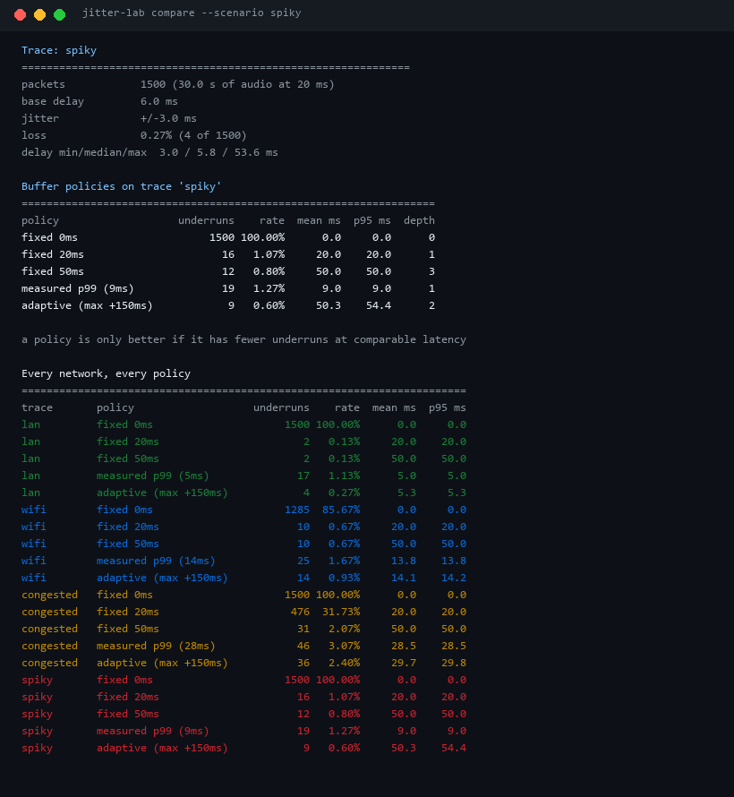
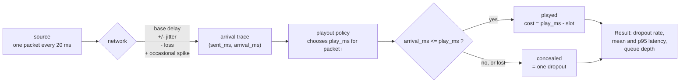
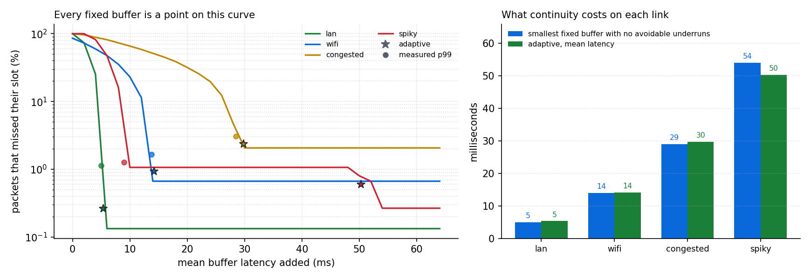
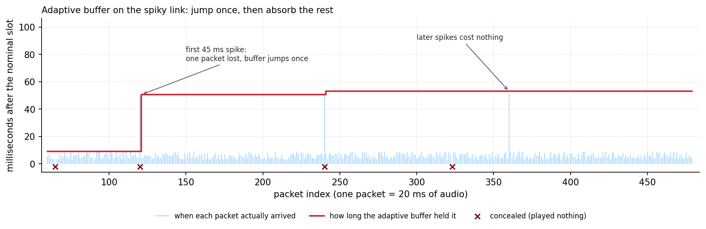

# Jitter-Buffer-Lab

**A real-time audio stream must be played by a clock that is not allowed to move. Every buffer policy is a bet about how late the network will be - this replays the same packet arrivals through six of them and prices each bet in milliseconds of latency and in audible dropouts.**

The number a fixed buffer needs cannot be known before deployment, and the number an adaptive buffer
finds for itself can be measured. This repository measures it: four link models, 1500 packets of
20 ms audio each, six playout policies, and the oracle value that no fixed buffer beats.



Every number in this README comes from `scripts/render_assets.py` running this repository's code on
the committed example traces. Nothing is transcribed by hand.

---

## Table of contents

- [Why this exists](#why-this-exists)
- [The model](#the-model)
- [What "enough buffer" means](#what-enough-buffer-means)
- [No fixed delay is right for two links](#no-fixed-delay-is-right-for-two-links)
- [Sizing on the tail still misses the tail](#sizing-on-the-tail-still-misses-the-tail)
- [What an adaptive buffer actually buys](#what-an-adaptive-buffer-actually-buys)
- [Watching one policy think](#watching-one-policy-think)
- [Install and run](#install-and-run)
- [Commands](#commands)
- [Trace format](#trace-format)
- [Design notes and limits](#design-notes-and-limits)
- [Tests](#tests)
- [License](#license)

---

## Why this exists

A voice call is not a file download. The receiver cannot wait for a packet, because the speaker's
mouth has already moved on: packet *i* is due exactly `20 ms` after packet *i-1*, whether or not it
has arrived. So the receiver holds every packet it gets for a fixed extra moment - the jitter buffer
- and if a packet is still missing when its slot comes up, it plays silence or a guess and the
listener hears a click.

That trades two things that both annoy humans:

| Hold longer | Hold less |
| --- | --- |
| Dropouts go down | Dropouts go up |
| The conversation feels laggy and people talk over each other | The conversation feels immediate |
| Costs nothing in bandwidth | Still cannot rescue a packet that never arrived |

The interesting question is not "should there be a buffer" - it is **how the number gets chosen**,
and whether the choice survives a link that changes under it. That is what this tool measures.

## The model



Four link models are generated deterministically from a seed, and one captured trace is read from
disk so the file format is exercised by the tool itself:

| Trace | Base delay | Jitter | Loss | Spikes | Packets dropped by the network |
| --- | ---: | ---: | ---: | --- | ---: |
| `lan` | 3 ms | ±2 ms | 0.05% | - | 2 / 1500 (0.13%) |
| `wifi` | 6 ms | ±8 ms | 0.40% | - | 10 / 1500 (0.67%) |
| `congested` | 15 ms | ±14 ms | 2.00% | - | 31 / 1500 (2.07%) |
| `spiky` | 6 ms | ±3 ms | 0.20% | +45 ms every 120 packets | 4 / 1500 (0.27%) |

Those last-column numbers matter more than they look: they are the **floor**. A lost packet is lost
at every buffer size, so no policy can score better than the loss rate, and a policy that lands
exactly on the floor has rescued every packet that was still recoverable.

## What "enough buffer" means

Run the fixed-delay sweep down to the millisecond and the answer is a step function: below it,
dropouts; at it, none but the losses.

| Trace | Smallest fixed delay with zero avoidable dropouts | Loss floor |
| --- | ---: | ---: |
| `lan` | 5 ms | 0.13% |
| `wifi` | 14 ms | 0.67% |
| `congested` | 29 ms | 2.07% |
| `spiky` | 54 ms | 0.27% |

That is the oracle: the best a fixed buffer could possibly do, and it needed a full trace in
hindsight to find it. The rest of this README is about how close each policy gets **without** that
trace.



## No fixed delay is right for two links

Every policy, every link, from `python -m jitter_buffer_lab scenarios`:

| Trace | Policy | Dropouts | Rate | Mean latency | p95 latency |
| --- | --- | ---: | ---: | ---: | ---: |
| lan | clock only (0 ms) | 1500 | 100.00% | 0.0 ms | 0.0 ms |
| lan | fixed 20 ms | 2 | 0.13% | 20.0 ms | 20.0 ms |
| lan | fixed 50 ms | 2 | 0.13% | 50.0 ms | 50.0 ms |
| lan | measured p99 (5 ms) | 17 | 1.13% | 5.0 ms | 5.0 ms |
| lan | adaptive | 4 | 0.27% | 5.3 ms | 5.3 ms |
| wifi | clock only (0 ms) | 1285 | 85.67% | 0.0 ms | 0.0 ms |
| wifi | fixed 20 ms | 10 | 0.67% | 20.0 ms | 20.0 ms |
| wifi | fixed 50 ms | 10 | 0.67% | 50.0 ms | 50.0 ms |
| wifi | measured p99 (14 ms) | 25 | 1.67% | 13.8 ms | 13.8 ms |
| wifi | adaptive | 14 | 0.93% | 14.1 ms | 14.2 ms |
| congested | clock only (0 ms) | 1500 | 100.00% | 0.0 ms | 0.0 ms |
| congested | fixed 20 ms | 476 | 31.73% | 20.0 ms | 20.0 ms |
| congested | fixed 50 ms | 31 | 2.07% | 50.0 ms | 50.0 ms |
| congested | measured p99 (28 ms) | 46 | 3.07% | 28.5 ms | 28.5 ms |
| congested | adaptive | 36 | 2.40% | 29.7 ms | 29.8 ms |
| spiky | clock only (0 ms) | 1500 | 100.00% | 0.0 ms | 0.0 ms |
| spiky | fixed 20 ms | 16 | 1.07% | 20.0 ms | 20.0 ms |
| spiky | fixed 50 ms | 12 | 0.80% | 50.0 ms | 50.0 ms |
| spiky | measured p99 (9 ms) | 19 | 1.27% | 9.0 ms | 9.0 ms |
| spiky | adaptive | 9 | 0.60% | 50.3 ms | 54.4 ms |

Three things fall out of that table:

1. **A clock with no buffer is not a policy.** At 0 ms of hold, `lan` loses 100% of packets: the
   smallest delay in the whole model is 1 ms and the deadline is "now". This is what a naive
   receiver does, and it is why the buffer exists at all.
2. **20 ms is a good guess on `lan`, a bad one on `congested`.** The same 20 ms is 0.13% of packets
   on a LAN and **31.73%** on a congested link. One constant cannot serve both.
3. **50 ms is safe and wasteful.** It hits the loss floor on three of the four links - and on `wifi`
   it holds every packet for 36 ms longer than the 14 ms that would have done the same job.

## Sizing on the tail still misses the tail

The obvious fix for "20 ms is average thinking" is to measure the link and size from a high
percentile. That is honest engineering - and it still loses, because a percentile is a definition of
what you are willing to drop:

| Trace | measured p99 | Dropouts | Oracle fixed delay | Dropouts |
| --- | ---: | ---: | ---: | ---: |
| lan | 5 ms | 17 | 5 ms | 2 |
| wifi | 14 ms | 25 | 14 ms | 10 |
| congested | 28 ms | 46 | 29 ms | 31 |
| spiky | 9 ms | 19 | 54 ms | 4 |

On `wifi` the p99 buffer is 13.8 ms and the oracle is 14 ms - 0.2 ms apart - and yet 25 packets
miss their slot instead of 10. The reason is the rank: with 1490 arrivals, the 99th percentile sits
between the 14th-slowest packets, so the 15 slowest are **late by construction**. On a bounded,
symmetric jitter model the p99 is nearly the maximum and the last fraction of a millisecond decides
15 packets. Sizing from a percentile needs a margin on top, not a percentile alone.

On `spiky` the failure is different and larger: 99% of packets arrive within 9 ms, so a p99 buffer
is blind to the 45 ms spike that 1% of the time ruins everything.

## What an adaptive buffer actually buys

An adaptive buffer measures instead of guessing, and it is the only policy here that needs no
advance knowledge of the link. Against the oracle:

| Trace | Oracle fixed delay | Adaptive mean latency | Gap | Adaptive dropouts | Oracle dropouts |
| --- | ---: | ---: | ---: | ---: | ---: |
| lan | 5 ms | 5.3 ms | +0.3 ms | 4 | 2 |
| wifi | 14 ms | 14.1 ms | +0.1 ms | 14 | 10 |
| congested | 29 ms | 29.7 ms | +0.7 ms | 36 | 31 |
| spiky | 54 ms | 50.3 ms | **-3.7 ms** | 9 | 4 |

It lands within a millisecond of the hindsight-optimal fixed buffer on the three links whose jitter
is bounded, and on `spiky` it spends **less** latency than the oracle would have needed - because it
only pays for the spike while the spike is happening, instead of carrying 54 ms around all day.

The price is on the right-hand column: it costs a few packets to relearn. Every measurement-driven
jump happens after a packet has already missed its slot, so `adaptive` sits at the loss floor plus a
handful of packets - +2 on `lan`, +4 on `wifi`, +5 on `congested`, +5 on `spiky`. That is the actual
trade, and it is a good one: 5 packets out of 1500 is a handful of clicks, where a wrong constant is
476 clicks.

Broken out by cause on the spiky link, all 9 concealed packets are accounted for:

| Packets | Why it was concealed |
| --- | --- |
| 65, 323, 621, 933 | dropped by the network - no buffer size recovers these |
| 120 | the first 45 ms spike, measured after the fact |
| 240, 480 | later spikes that overshot the hold by 1.4 ms and 0.4 ms |
| 2, 6 | warm-up: the buffer has seen one packet and cannot know the link's range yet |

## Watching one policy think



The light lines are when each packet arrived; the red step is how long the buffer chose to hold it.
Three details are visible, and all three are implemented deliberately:

- **The first spike costs exactly one packet.** The jump is sized from the observed deficit, so
  packet 120 is lost and packet 121 onwards is already covered.
- **The jump does not rescue the packet that caused it.** A real-time receiver cannot move a deadline
  it has already passed; the tool refuses to pretend otherwise.
- **The hold never comes back down here.** Releasing a step of delay requires 400 packets in a row
  with more than a step of headroom, and this link spikes every 120 packets. A buffer that never
  sees a calm link is right not to relax.

## Install and run

Python 3.10 or newer, no runtime dependencies.

```console
$ git clone https://github.com/abubakarsiddique360/Jitter-Buffer-Lab.git
$ cd Jitter-Buffer-Lab
$ python -m pip install -e ".[dev]"

$ python -m jitter_buffer_lab compare --scenario spiky
$ python -m jitter_buffer_lab scenarios
$ python -m jitter_buffer_lab frontier --scenario congested --step 5
$ python -m jitter_buffer_lab required --scenario wifi
$ python -m jitter_buffer_lab save --scenario wifi --packets 500 --out examples/capture.json
$ python -m jitter_buffer_lab compare --trace-file examples/capture.json
```

Or without installing anything:

```console
$ $env:PYTHONPATH="src"      # PowerShell
$ PYTHONPATH=src             # bash
$ python -m jitter_buffer_lab scenarios
```

## Commands

| Command | What it answers |
| --- | --- |
| `trace` | What does this link look like? Delay range, loss rate, duration. |
| `compare` | Every policy on one trace, side by side. |
| `run` | One policy, one trace, one row - including the hold it chose per packet. |
| `scenarios` | The full cross product: four links x five policies. |
| `frontier` | Dropouts against delay for a fixed buffer, in steps you choose. |
| `required` | The smallest fixed delay that rescues every packet the network delivered. |
| `save` | Write a generated trace to JSON so it can be replayed or hand-edited. |

Every command accepts `--scenario` or `--trace-file`, `--packets`, and `--seed`, so any number in
this README can be regenerated. `compare`, `run`, `scenarios` and `frontier` also take
`--format json` for scripting.

`required` exits `1` when the sweep hits its `--max-ms` limit without finding a buffer that recovers
everything - a signal, not a crash.

## Trace format

A trace is a flat list of packets with the two numbers the simulation actually needs:

```json
{
  "name": "hand-written",
  "interval_ms": 20.0,
  "jitter_ms": 2.0,
  "loss": 0.05,
  "base_delay_ms": 5.0,
  "packets": [
    {"index": 0, "sent_ms": 0, "arrival_ms": 4, "payload_bytes": 960},
    {"index": 15, "sent_ms": 300, "arrival_ms": null, "payload_bytes": 960}
  ]
}
```

`arrival_ms: null` is a lost packet. The descriptive fields are optional and only used for the
summary header, so a trace captured from a real socket needs nothing but `packets`.

## Design notes and limits

**What the simulation models.** Nominal send times, one-way delay with uniform jitter, packet loss,
rare large spikes, and a playout decision per packet. Latency is measured from the packet's nominal
slot to its play time, which is the number a listener feels.

**What it deliberately does not model.** Reordering, packet-loss concealment (a concealed packet is
counted as a dropout, not synthesised), codec behaviour, bandwidth adaptation, or decode time. The
model is small so that the arithmetic in the README can be checked by hand.

**Two policies that look alike.** `measured p99` and `fixed` produce the same shape of schedule -
only the number differs, and the number comes from the trace instead of from the command line. That
is the point: the interesting difference between policies is *where the number comes from*.

**Why adaptive jumps instead of sliding.** An underrun is audible and a 2 ms latency change is not,
so the implementation reacts immediately and recovers slowly. The recovery is gated on headroom
(`play - arrival > step`) rather than on a packet count alone, because a count-only decay oscillates
around the link's real minimum and turns a stable 2 ms link into a stream of avoidable dropouts.

**Why the first arrival prefills.** A receiver does not start its clock before it has any audio. If
it did, every policy would open with a forced dropout and the comparison would be measuring start-up
instead of steady state. One packet is not a link model, though, so the first few packets of a
variable link can still be late - packets 2 and 6 of the spiky trace are exactly that.

**Where the numbers are fragile.** `measured p99` is sensitive to rank arithmetic near the maximum,
as the `wifi` row shows. `adaptive` is sensitive to `calm_packets`: raise it and the buffer holds
latency for longer, lower it and the hold oscillates. Both are exposed as function arguments
(`adaptive(calm_packets=...)`) even though the CLI uses the defaults.

## Tests

89 tests, no network access, no external data.

```console
$ python -m pytest -o addopts="" -q
89 passed

$ python -m ruff check .
All checks passed!
```

The suite pins the arithmetic rather than the prose: hand-built traces with known arrivals assert
which packets play and which are concealed, the adaptive policy is checked for the jump-once
property, the no-retroactive-deadline property, the headroom gate and the prefill, and the CLI is
exercised through `main()` including its non-zero exit codes.

## License

MIT. See [LICENSE](LICENSE).
